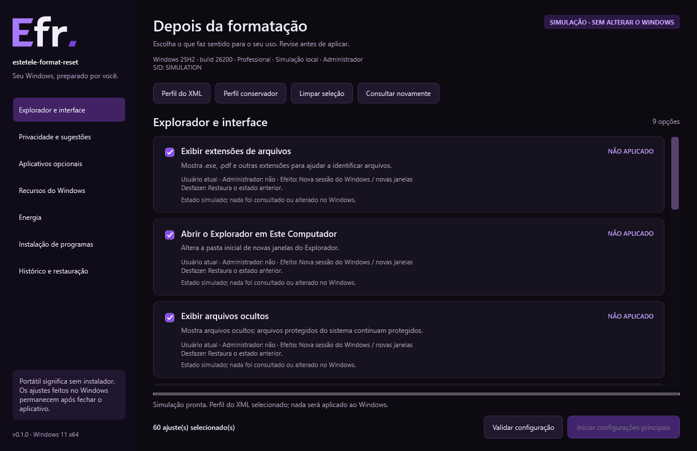
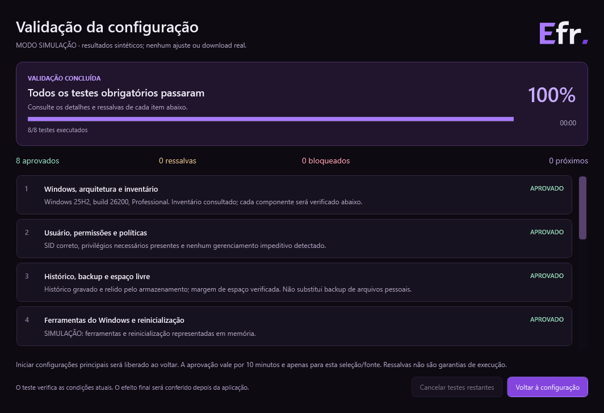

<p align="center"></p>

# estetele-format-reset · Efr

**Personalização pós-instalação do Windows 11, com seleção individual, validação e histórico.** Aplicativo portátil para Windows x64, desenvolvido por **Tiago Estetele**, com interface nativa em português e tema preto e roxo.

O EFR ajuda a configurar um Windows já instalado. **Não formata discos, não restaura o Windows e não executa o XML original.** Seu catálogo foi inspirado em um `autounattend.xml`, adaptando apenas as operações implementadas para uso após a instalação.

> **Estado: experimental / pré-lançamento 0.1.0.** Os testes automatizados e a verificação visual usam simulação. Também há uma verificação nativa somente de leitura. Aplicações e restaurações reais ainda precisam de testes em VM descartável. Não há promessa de ganho de desempenho nem de ausência de falhas. Consulte os [resultados e limites](docs/VALIDACAO.md).

## Navegação

- [Download e requisitos](#download-e-requisitos)
- [Primeiro uso](#primeiro-uso)
- [Recursos e reversão](#recursos-e-reversão)
- [Como funciona a validação](#como-funciona-a-validação)
- [Histórico, privacidade e rede](#histórico-privacidade-e-rede)
- [Simulação](#simulação)
- [Compilar e testar](#compilar-e-testar)
- [Solução de problemas](#solução-de-problemas)
- [Contribuir, versionar e licença](#contribuir-versionar-e-licença)

## Download e requisitos

Quando houver uma versão publicada, baixe o **ZIP do aplicativo na área Releases** do repositório `TiagoEstetele/estetele-format-reset`. O ZIP automático **Source code** contém o código-fonte e não o programa compilado. A existência deste README não significa que já há uma Release disponível.

Extraia `estetele-format-reset-win-x64.zip` em uma pasta gravável e abra `estetele-format-reset.exe`. Não é necessário instalar o .NET, Python, Node ou PowerShell 7. O pacote inclui o runtime .NET e os avisos de licença de seus componentes. O executável tem aproximadamente **134 MiB** por incluir o runtime.

| Requisito | Detalhe |
|---|---|
| Sistema | Windows 11 cliente, x64. Windows 10, Windows Server e ARM64 não são alvos suportados |
| Conta | Conta que receberá a personalização; alterações do computador exigem administrador da **mesma conta** |
| Ferramentas | Windows PowerShell 5.1 e componentes nativos do Windows |
| Internet | Necessária para instaladores e .NET via Windows Update; ajustes locais não dependem de download |
| Espaço | Pré-validação exige margem de 2 GiB no volume do histórico para instalações/.NET; 10 MiB para demais seleções. Instaladores podem exigir espaço adicional em outros volumes |
| Ambiente | Computadores pessoais sem gerenciamento impeditivo de domínio/MDM/políticas locais |
| Escrita local | Pasta temporária gravável para extração do runtime e cache dos instaladores; histórico no perfil do usuário |

O binário atual **não tem assinatura de distribuição**. Verifique a origem e o hash; não desative proteções do Windows para executá-lo. O hash permite comparar o arquivo com o manifesto obtido de fonte confiável, mas não substitui uma assinatura digital.

Para conferir o ZIP ou o executável extraído:

```powershell
Get-FileHash .\estetele-format-reset-win-x64.zip -Algorithm SHA256
Get-FileHash .\estetele-format-reset.exe -Algorithm SHA256
```

Compare com as entradas correspondentes em `SHA256SUMS.txt` da mesma Release.

## Primeiro uso

1. Abra o executável na conta que deseja personalizar. Abrir o EFR não aplica ajustes.
2. Revise o **Perfil do XML**, selecionado inicialmente. Ele inclui operações com impacto: remoções opcionais, remoção do Bloco de Notas, instalação do Notepad++, Firefox, Visual C++ e Desempenho Máximo. Itens já aplicados, ausentes ou indisponíveis são tratados conforme a detecção.
3. Desmarque o que deseja preservar. **Perfil conservador** seleciona somente extensões visíveis e abertura do Explorador em Este Computador. **Limpar seleção** desmarca todos os itens.
4. Se necessário, use **Reabrir como administrador** com a mesma conta. A nova janela consulta o estado novamente; revise a seleção. Credenciais de outra conta são bloqueadas para evitar personalizar o usuário errado.
5. Clique em **Validar configuração**, revise a seleção e a fonte .NET, se utilizada, e confirme o início dos testes. Instaladores selecionados podem ser baixados nessa fase, sem execução.
6. Acompanhe a tela de testes. Corrija os bloqueios, ajuste a seleção e valide novamente quando necessário.
7. Após aprovação, clique em **Iniciar configurações principais** e confirme a revisão final, incluindo as ressalvas. A validação vale por dez minutos e é invalidada por mudanças na seleção/fonte ou nova consulta.
8. Acompanhe o resultado por operação e a verificação posterior. Reinicializações são sempre manuais.
9. Em **Histórico e restauração**, use **Restaurar original** nos ajustes reversíveis, quando houver backup ativo. Mudanças externas conflitantes bloqueiam a restauração.

A opção de criar ponto de restauração é explícita e depende da Proteção do Sistema já disponível. O EFR não habilita esse recurso automaticamente. Um ponto de restauração e os backups do EFR não substituem uma cópia dos arquivos pessoais.

### Interface

As imagens abaixo são geradas pelo próprio WPF em **simulação**, com dados sintéticos; não mostram alterações no computador do autor.





## Recursos e reversão

| Área | O que faz | Como desfazer / restrições |
|---|---|---|
| Explorador | Extensões, arquivos ocultos e abrir em Este Computador | Restaura tipo, conteúdo e ausência originais dos valores; alguns efeitos exigem nova sessão |
| Entrada | Aceleração do mouse e Teclas de Aderência via APIs do Windows | Backup do estado nativo e dos valores originais; pode afetar acessibilidade |
| Compatibilidade | Caminhos longos | Reversível; cada programa também precisa suportar caminhos longos |
| Políticas | Widgets, pesquisa web, experiências de consumidor e três preferências do Edge | Restrições por edição; políticas preexistentes de terceiros não são substituídas |
| Aplicativos Appx | Remoção individual de 34 identidades opcionais | Apenas conta atual; sem remoção de provisionamento/outras contas. Reinstalação pela Store pode ser necessária e não recupera automaticamente dados |
| Recursos/capacidades | RDP Client, Recall e capacidades opcionais detectadas | Não oferece restauração automática; recuperação pelo Windows pode exigir internet/mídia |
| Programas | Firefox, Notepad++ e Visual C++ Redistributable x64 | Download oficial com assinatura validada; desinstalação/gerenciamento pelo Windows |
| .NET 3.5 | Até build 27999: Windows Update ou fonte `sources\sxs` compatível | A partir da build 28000, oferece orientação para o instalador separado da Microsoft |
| Energia | Planos existentes e Desempenho Máximo | Guarda plano anterior; usa uma cópia gerenciada quando necessário. Suporte depende do hardware/Windows |
| Histórico | Backup antes da escrita, verificação posterior e restauração | Vinculado ao computador e SID; alterações externas são preservadas por bloqueio de conflitos |

**Notepad++ e Bloco de Notas:** instaladores são processados antes das remoções. Se a instalação selecionada do Notepad++ falhar, a remoção selecionada do Bloco de Notas é ignorada nesse lote. Associações de arquivos não são alteradas automaticamente.

**Energia:** Desempenho Máximo vem pré-selecionado quando aplicável, mas só é ativado após validação e confirmação. Pode aumentar consumo, temperatura e ruído, e reduzir a autonomia. O EFR não altera firmware nem desativa Modern Standby. Se quiser outro plano, selecione somente um por lote.

**Orientações manuais:** alinhamento da barra, Visão de Tarefas, Finalizar tarefa, sugestões gerais e OneDrive. O menu clássico não é automatizado. O OneDrive exige revisão de sincronização, arquivos somente online e backup de pastas antes de desinstalar.

**Preservados:** Defender, SmartScreen, Smart App Control, indicadores de segurança, Windows Update, BitLocker, Windows Hello, Microsoft Store, App Installer e WebView2. O projeto não inclui ajustes para desativar essas proteções, alterar política de execução do PowerShell ou modificar arquivos internos do Edge.

A [análise do XML](docs/ANALISE-XML.md) explica adaptações, exclusões e fontes oficiais. O XML original não é necessário para compilar ou executar o EFR e não é distribuído.

## Como funciona a validação

Cada seleção gera **quatro verificações globais e dois testes por item**:

| Etapa | Verificação |
|---|---|
| Inventário | Windows, arquitetura, edição, aplicativos e componentes disponíveis |
| Contexto | Conta/sessão, privilégios, gerenciamento e seleção única de plano de energia |
| Histórico | Gravação, releitura, vínculo da conta e margem de espaço |
| Ferramentas | Cmdlets necessários e reinicialização pendente para operações de instalação/servicing |
| Estado por item | Presença, compatibilidade, restrições e detecção atual |
| Método por item | Backup serializável e acesso; ou dependências, fonte .NET, download/assinatura/hash, conforme a operação |

A tela mostra o teste atual, percentual baseado em testes executados, tempo decorrido, aprovados, ressalvas, bloqueados e próximos testes. Cancelar aguarda o teste atual e cancela os seguintes; testes cancelados não aumentam o percentual de testes executados.

- **Aprovado:** a condição consultada foi atendida.
- **Ressalva:** existe um limite explícito da verificação; não bloqueia sozinha, mas aparece novamente na confirmação.
- **Bloqueado:** falha obrigatória; o início permanece desabilitado.
- **Cancelado/incompleto:** não autoriza a aplicação.

A pré-validação não instala ou remove componentes para provar que a operação funcionará. Criação de plano ausente, payload .NET e condições futuras não podem ser garantidos por consulta. Arquivos em uso, políticas, rede ou atualizações podem mudar após os testes. O programa verifica novamente o resultado depois de aplicar e informa pendências de reinicialização.

A fila de aplicação pode ser parada **entre operações**. DISM e instaladores em andamento não são encerrados à força. Operações não reversíveis podem ter efeitos parciais em caso de falha.

## Histórico, privacidade e rede

Histórico real:

```text
%LOCALAPPDATA%\estetele-format-reset\history-v1
```

A pasta contém `history.json`, versão anterior quando disponível, trava de sessão e relatórios na subpasta `validations`. Registra SID, nome do computador, operações, resultados e valores necessários à restauração. **Não publique essa pasta inteira em uma issue.** Remova dados pessoais de evidências compartilhadas.

Não há telemetria própria do EFR. O programa usa rede quando precisa obter instaladores oficiais, verificar assinaturas ou consultar o Windows Update. Esses serviços e os programas instalados possuem suas próprias políticas. Principais origens: Mozilla e seu CDN, Microsoft (`aka.ms` e endpoints oficiais de download), API/repositório oficial do Notepad++ no GitHub e CDN de assets do GitHub.

O cache temporário usa diretórios `EFR-<identificador>` para instaladores selecionados. O aplicativo verifica assinatura/publicador e revalida o arquivo antes da execução; Notepad++ exige também SHA-256 informado pela release oficial. A limpeza normal remove somente os arquivos temporários pertencentes ao EFR. Encerramentos abruptos podem deixar temporários.

Guarde o histórico se pretende restaurar ajustes. Não o copie para outra conta/computador. Não execute alterações simultâneas por contas diferentes ou por outros utilitários: a trava de histórico protege uma conta, não todo o sistema.

## Simulação

```powershell
.\estetele-format-reset.exe --demo
```

Nesse modo, detecção, aplicação e restauração usam memória; não há downloads nem ajustes reais. A interface identifica claramente a simulação. O histórico fica separado em `demo-history` ao lado do executável.

```powershell
.\estetele-format-reset.exe --demo --demo-directory "C:\Pasta gravável\EFR-demo"
```

## Compilar e testar

Requer **Windows x64, Git e SDK .NET 10**, conforme `global.json` (10.0.403 com atualizações de patch permitidas). O aplicativo não depende de pacotes externos de interface. Restauração de dependências usa o `NuGet.Config` do projeto.

```powershell
git clone https://github.com/TiagoEstetele/estetele-format-reset.git
cd estetele-format-reset
.\tools\build.ps1
```

O comando de clone estará disponível após a primeira publicação do repositório. Se o SDK estiver em um caminho próprio, use `./tools/build.ps1 -Dotnet "C:\SDK\dotnet.exe"`. Não é preciso executar o build como administrador.

O script restaura dependências, executa a suíte isolada, publica o `.exe`, testa a interface em simulação e empacota os arquivos. Saídas:

```text
estetele-format-reset.exe                 cópia conveniente na raiz
dist/win-x64/estetele-format-reset.exe   executável autossuficiente
dist/estetele-format-reset-win-x64.zip   pacote de distribuição com documentação/licenças
dist/SHA256SUMS.txt                     hashes do executável e ZIP
artifacts/test-results.txt             relatório de testes isolados
artifacts/ui-check/<execução>/          seis telas PNG e resultado da interface simulada
```

### Comandos de teste separados

```powershell
# Suíte isolada: backend em memória, sem alterações do Windows.
dotnet run --project tests/Efr.Tests/Efr.Tests.csproj -c Release

# Interface do executável publicado: força simulação e usa histórico exclusivo.
.\tools\test-ui.ps1

# Diagnóstico opcional: somente consultas reais; grava relatório local em artifacts.
dotnet run --project tests/Efr.Tests/Efr.Tests.csproj -c Release -- --native-readonly
```

A suíte é um programa de testes próprio; **`dotnet test` não a executa**. O diagnóstico nativo não faz parte do CI, não aplica/restaura ajustes e identifica consultas que exigem elevação como pendentes.

O workflow em `.github/workflows/ci.yml` executa build, testes isolados, interface simulada e empacotamento em Windows a cada push em `main` ou pull request. Publica artefatos temporários de teste; **não publica uma Release automaticamente**. O primeiro resultado remoto só existirá após enviar o repositório ao GitHub.

### Estrutura

```text
src/Efr.Core/       catálogo, motor, APIs, validação, backup, downloads e simulação
src/Efr.App/        interface WPF, seleção, revisão, progresso e histórico
tests/Efr.Tests/   suíte isolada e diagnóstico nativo somente de leitura
assets/           logo SVG/PNG e ícone ICO
docs/             análise, arquitetura, testes, publicação, imagens e licenças
tools/            build, teste visual, empacotamento e geração do logo
.github/          CI, Dependabot e modelos de contribuição
```

SDK local, binários, histórico e resultados ficam fora do Git. O SVG é editável; `tools/RenderLogo.ps1` reproduz os PNGs e o ICO. Consulte a [arquitetura](docs/ARQUITETURA.md) antes de adicionar operações.

## Solução de problemas

| Situação | O que fazer |
|---|---|
| Não encontro o `.exe` no clone | O Git contém fontes. Use a Release ou execute `tools/build.ps1` |
| Botão Iniciar desabilitado | Selecione itens elegíveis e conclua a validação sem bloqueios; uma aprovação expirada precisa ser refeita |
| Recurso exige administrador | Reabra pela opção do EFR com a mesma conta e revise a seleção |
| Conta incorreta ou computador gerenciado | Use a conta correta; não tente contornar políticas organizacionais |
| Recurso ausente/edição incompatível | Consulte o detalhe do item; nem todo componente existe em toda build/edição |
| Reinicialização pendente | Salve seu trabalho, reinicie manualmente e valide novamente |
| Download ou assinatura falhou | Confira conexão/data/hora e origem; não execute arquivos que reprovaram a validação |
| Notepad++ falhou | A remoção do Bloco de Notas selecionada no mesmo lote é ignorada; consulte o histórico |
| Desempenho Máximo indisponível | Use um plano existente compatível; não altere firmware ou Modern Standby como contorno |
| Histórico inválido ou em uso | Feche outra instância; preserve uma cópia do histórico para diagnóstico. Não edite backups para forçar restauração |
| Restauração detectou conflito | Houve mudança externa. Revise o valor e o histórico antes de qualquer recuperação manual |
| Programa não abre por extração do runtime | Verifique espaço/permissão da pasta temporária; não precisa instalar o SDK. Em ambientes restritos, uma pasta de extração gravável pode ser necessária |
| Uma opção não mudou visualmente | Algumas preferências exigem nova sessão/reinício; releia os detalhes. Estado gravado não prova que toda interface já reagiu |

Para reportar um bug, informe versão do EFR, build/edição do Windows, modo normal/simulação, seleção e mensagem de erro. Não envie SID, credenciais, histórico completo ou XML de instalação. Para segurança, consulte [SECURITY.md](SECURITY.md).

## Contribuir, versionar e licença

- [Guia de contribuição](CONTRIBUTING.md)
- [Identidade, autorização e credenciais](docs/AUTENTICACAO.md)
- [Versionar e publicar no GitHub](docs/GITHUB.md)
- [Resultados, limites e roteiro de VM](docs/VALIDACAO.md)
- [Changelog](CHANGELOG.md)
- [Avisos de terceiros](THIRD-PARTY-NOTICES.md)

Código e identidade visual originais sob **[licença MIT](LICENSE)**. Copyright © 2026 **Tiago Estetele**. Windows, Microsoft, Mozilla e Notepad++ pertencem aos respectivos titulares; o projeto não é afiliado a eles.
