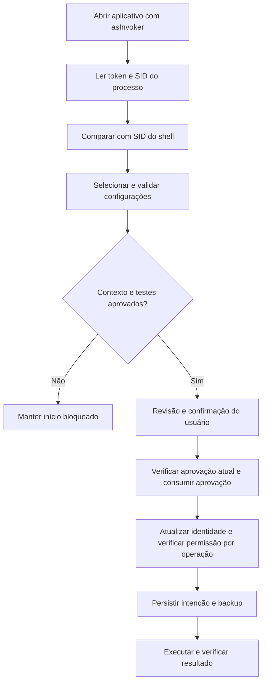

# Identidade, autorização e credenciais

O EFR é um aplicativo desktop local. Não há servidor HTTP, cadastro, sessão web, OAuth próprio, JWT, cookie de autenticação ou senha do aplicativo. A identidade vem da sessão autenticada pelo Windows; a autorização combina privilégios do processo e verificações do EFR.

## Componentes

| Componente | Responsabilidade |
|---|---|
| `src/Efr.App/app.manifest` | Inicia com `asInvoker`: herda os privilégios de quem abriu o programa |
| `Native.Machine` / `Native.ShellSid` em `WindowsPrimitives.cs` | Lê identidade/SID do processo e do shell, verifica administrador, plataforma e gerenciamento |
| `MainWindow.AdminClick` | Reinicia usando `runas`, deixando a elevação sob controle do Windows |
| `Preflight` e `ValidationReport` | Testam contexto e seleção; aprovação expira em dez minutos |
| `WindowsBackend.AssertCanWrite` | Atualiza a identidade e recusa escrita com contexto incompatível |
| `Engine` | Chama as verificações antes de aplicar/restaurar e persiste backup antes de mutações |
| `Journal` | Rejeita histórico de outro SID/computador, schema incompatível e estruturas inválidas |

## Fluxo de uma operação

`Native.Machine` usa `WindowsIdentity.GetCurrent()` e `WindowsPrincipal.IsInRole(Administrator)`. `ShellSid` encontra a janela do shell, abre seu processo com acesso limitado e consulta seu token para ler o SID. Os handles de processo/token são fechados em `finally`; os objetos de identidade são descartados.

A condição de identidade exige SID não vazio, igualdade entre o SID do aplicativo e o shell e, quando há `--expected-sid`, igualdade com o SID de origem. Se a leitura falhar ou uma conta administrativa diferente for usada, a escrita é recusada. A checagem não transforma SID em segredo: SID é identificador de conta.

Na elevação, a interface chama `Process.Start` com `UseShellExecute=true` e `Verb="runas"`. Passa `--expected-sid` e `--wait-pid` para preservar o vínculo de identidade e aguardar a janela anterior liberar o histórico. O Windows apresenta o UAC; o EFR não recebe a senha digitada nele. Os argumentos são contexto, não credenciais nem prova criptográfica independente.

A validação relaciona a aprovação à seleção, valores desejados, fonte .NET, SID, build, edição, privilégios, gerenciamento, identidade e suporte. O fingerprint é SHA-256 desses dados. **Não é um token secreto nem assinado.** A autorização temporária fica na memória da interface e não é reimportada dos relatórios JSON. Alterar a seleção, atualizar o inventário ou deixar expirar exige nova validação.

Antes de cada alteração, `AssertCanWrite` consulta a máquina novamente e bloqueia plataforma não suportada, identidade divergente, gerenciamento impeditivo, falta de administrador e políticas de terceiros. As permissões efetivas do Windows continuam sendo a barreira de segurança; os controles do EFR não pretendem conter código malicioso executado na mesma conta ou um administrador local.

## Dados persistidos e downloads

- `Journal` grava SID, computador, resultados e valores necessários à restauração em `%LOCALAPPDATA%/estetele-format-reset/history-v1`. Não grava senha ou token de login e não adiciona criptografia própria. Não publique o histórico completo.
- Backups são vinculados a conta/computador e verificados contra o estado atual para evitar sobrescrever mudanças externas. O JSON não é assinado digitalmente nem um cofre de segredos.
- `Installers` acessa endpoints públicos por HTTPS, sem cabeçalho `Authorization`, PAT ou token OAuth. O acesso à API pública do Notepad++ pode sofrer limites de requisições sem autenticação.
- URLs de download têm lista permitida de origens, rejeição de credenciais embutidas e porta diferente de 443. Assinatura Authenticode, publicador e, para Notepad++, hash da release verificam o instalador. Isso autentica a origem do software, não o usuário.
- `CancellationToken` e `CancellationTokenSource` encontrados nos testes/rotinas assíncronas são mecanismos de cancelamento, não tokens de acesso.

## GitHub e CI

A conta do mantenedor no GitHub é independente da conta usada pelo aplicativo. Configurar `git user.name` e `git user.email` define autoria de commits; não faz login. Push/criação de repositório precisam da autenticação do Git/GitHub CLI ou da conexão do plugin, fora do EFR. O código não lê credenciais desses clientes.

O workflow `.github/workflows/ci.yml` pede `contents: read` e usa `persist-credentials: false` no checkout. Não declara PAT, chave privada, segredo do projeto, OIDC ou permissão de publicação. As credenciais temporárias fornecidas pelo GitHub Actions ficam sob controle do runner/ações, não do executável distribuído.

Veja também [arquitetura](ARQUITETURA.md), [política de segurança](../SECURITY.md) e [publicação](GITHUB.md).
